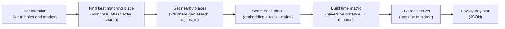

# TravelApp AI – Smart Trip Planner
 
TravelApp AI is a FastAPI backend that builds **multi-day travel plans**. The user writes what they want in plain words (for example, *"I love temples and old markets"*), and the system picks the best places nearby and puts them into a day-by-day schedule.
 
The heart of the project is an **optimization engine** built with **Google OR-Tools** (constraint programming + routing). It answers one question:
 
> *"Given limited time, which places should we visit, in what order, and on which day, so the trip is as good as possible?"*
 
AI is used to understand the user and score places. Constraint programming is used to make the actual plan.
 
---
 
## Table of contents
 
1. [The problem in simple words](#1-the-problem-in-simple-words)
2. [How the whole pipeline works](#2-how-the-whole-pipeline-works)
3. [The optimization model](#3-the-optimization-model)
4. [Planning more than one day](#4-planning-more-than-one-day)
5. [Solver settings](#5-solver-settings)
6. [Worked example](#6-worked-example)
7. [API](#7-api)
8. [Project structure](#8-project-structure)
9. [Getting started](#9-getting-started)
10. [Known limitations and ideas](#10-known-limitations-and-ideas)
---
 
## 1. The problem in simple words
 
Imagine you are in Colombo for 2 days. There are 11 interesting places, but you only have about 10 hours a day. You cannot see everything, so you need to decide:
 
- **Which places to visit.** Some places match your interests better than others.
- **In what order.** A good order means less time in the car.
- **When.** A museum that closes at 5 PM must be visited before 5 PM.
- **On which day.** Each day has a limited time and a limited number of stops.
In optimization terms, this is a **Prize-Collecting Vehicle Routing Problem with Time Windows**, also known as the **Orienteering Problem with Time Windows (OPTW)**:
 
| Real world | Optimization term |
|---|---|
| A place to visit | Node |
| How much the user will like it | Prize / score |
| Driving between two places | Arc with a travel cost |
| Opening hours | Time window |
| How long you stay | Service time |
| Hours available per day | Capacity of the time dimension |
| Skipping a place | Dropping an optional node (with a penalty) |
 
---
 
## 2. How the whole pipeline works
 

 
### Step 1 – Understand the user and score places
 
File: `app/services/intents/intent_ranker.py`
 
Each place gets a **score** that says how well it matches the user:
 
```
final  = 0.6 × embedding_similarity   (meaning of the text, 0–1)
       + 0.4 × tag_overlap            (matching tags like "temple", 0–1)
       + rating / 5                   (Google-style rating, 0–1)
 
score  = int(final × 100)             → a number from 0 to 200
```
 
**Example:** For *"I love temples"*, a temple with a 4.5 rating might get `0.6×0.9 + 0.4×1.0 + 0.9 = 1.84`, so its score is **184**. A shopping mall might only get **70**.
 
This score becomes the **prize** in the optimization model.
 
### Step 2 – Turn distance into travel time
 
File: `app/services/planner/distance.py`
 
We do not call a maps API for every pair of places. Instead, we estimate the travel time:
 
```
straight_line_km = haversine(lat1, lon1, lat2, lon2)
minutes          = straight_line_km × road_factor / speed_kmph × 60
```
 
With the defaults (`road_factor = 1.25`, `speed_kmph = 30`):
 
**Example:** Two places 6 km apart (straight line) → `6 × 1.25 / 30 × 60` = **15 minutes**.
 
The `road_factor` adds 25% because real roads are not straight lines. Every pair of places goes into an **N × N time matrix**.
 
---
 
## 3. The optimization model
 
File: `app/services/planner/solver.py` → `solve_one_day()`
 
The model uses the OR-Tools **Routing Library**, which is built on top of OR-Tools' constraint programming solver.
 
### 3.1 Objective – what we try to minimise
 
$$
\text{minimise} \quad \sum_{\text{arcs used}} \text{travel\_time}(i, j) \times w \;+\; \sum_{\text{places skipped}} \text{score}_k \times 2
$$
 
In simple words: **drive as little as possible, but you get "punished" for every good place you skip.**
 
- `w` is `minimize_travel_weight` (default `1`).
- `2` is `score_to_minutes` (default `2`). It turns a score into "minutes of penalty".
**Example:** Pettah Market has a score of 90. Skipping it costs `90 × 2 = 180` penalty minutes. If visiting it only adds 15 extra minutes of driving, the solver will visit it, because 15 is much less than 180. A low-score place far away (for example, score 20, 60 minutes away) will be skipped, because 40 penalty is less than 60 minutes of driving.
 
So the score works like a **prize**. Higher score = the solver tries harder to include it.
 
### 3.2 Decision variables
 
OR-Tools creates these for us:
 
| Variable | Meaning |
|---|---|
| `NextVar(i)` | Which place comes after place `i` (this builds the route) |
| `ActiveVar(i)` | Is place `i` visited or skipped? (from the disjunction) |
| `CumulVar(i)` on the **Time** dimension | Clock time at place `i`, in minutes from midnight |
| `SlackVar(i)` on the **Time** dimension | Waiting time at place `i` |
| `CumulVar(i)` on the **Stops** dimension | How many places have been visited so far |
 
### 3.3 Constraints
 
**C1. Start and end of the day**
The route must start at `start_index` and finish at `end_index`. The start time is fixed:
 
```python
time_dim.CumulVar(start).SetRange(start_time_minutes, start_time_minutes)  # e.g. 480 = 08:00
```
 
**C2. Time flows forward (Time dimension)**
Moving from place A to place B adds travel time and the visit time at B:
 
```python
transit(A → B) = travel_time[A][B] + visit_duration[B]
```
 
**Example:** Leave Start at 08:00, drive 4 min to Pettah Market, stay 45 min → the time value at Pettah is 08:49.
 
**C3. Opening hours (time windows)**
Each place has `open_time` and `close_time` in minutes from midnight:
 
```python
time_dim.CumulVar(place).SetRange(open_time, close_time)
```
 
**Example:** A temple with `open_time = 540` and `close_time = 1020` can only be in the plan between 09:00 and 17:00.
 
**C4. Daily time budget**
The time dimension has a maximum value:
 
```python
max_end_time = start_time_minutes + daily_time_budget_minutes
```
 
**Example:** Start at 08:00 (480) with a 600-minute budget → the day must end by 18:00 (1080).
 
**C5. Limited waiting**
`max_wait_time` (default `60`) is the slack. You may wait up to 60 minutes at a place, for example if you are early and it is not open yet. You cannot wait longer than that.
 
**C6. Visiting places is optional (disjunctions)**
Every place except start and end is optional, with a penalty if skipped:
 
```python
routing.AddDisjunction([place], penalty=score * score_to_minutes)
```
 
This is what makes it a *prize-collecting* problem. Without this, the solver would have to visit every place, and the problem would often have no solution.
 
**C7. Maximum stops per day (Stops dimension)**
A second dimension counts visited places. Every arc that goes into a real place adds `1`. Arcs into the start or end add `0`:
 
```python
routing.AddDimension(stop_count_cb, 0, max_stops_per_day, True, "Stops")
```
 
**Example:** With `max_stops_per_day = 3`, the plan never has more than 3 places in one day, even if there is still time left. This keeps the trip relaxed.
 
---
 
## 4. Planning more than one day
 
File: `app/services/planner/multi_day.py` → `plan_trip_multi_day()`
 
A full multi-day model can get big and slow. Instead, the planner solves **one day at a time** (a *rolling horizon* / *sequential decomposition* approach):
 
```
remaining = all places
 
for each day:
    1. Solve one day using only the remaining places
    2. Remove the visited places from "remaining"
    3. Tomorrow starts where today ended
```
 
### The "EOD" (End Of Day) trick
 
On days that are **not** the last day, we do not know where the traveller will sleep. So the planner adds a fake end node called **EOD**:
 
- Travel time from any place to EOD is set to **0** (`flexible_end_index`).
- This means the day can end **at whatever place is visited last**, with no extra cost.
- The next day starts from that last real place.
**Example:** Day 1 ends at Kelaniya Temple. Day 2 starts at Kelaniya Temple at 08:00.
 
On the **last day**, the real `End` location is used, so the trip finishes at the right place (for example, the hotel or airport).
 
If all places are used up before the last day, the planner adds a short `"FINAL"` day that just goes to `End`.
 
---
 
## 5. Solver settings
 
| Setting | Value | Why |
|---|---|---|
| First solution | `PATH_CHEAPEST_ARC` | Quickly builds a first route by always going to the nearest next place |
| Improvement | `GUIDED_LOCAL_SEARCH` | Keeps improving the route and can escape "local minimum" traps |
| Time limit | `5` seconds per day | Good balance between speed and quality |
 
Guided Local Search usually keeps searching until the time limit, so a 3-day trip can take up to about **15 seconds**.
 
### All tunable parameters
 
| Parameter | Default (solver) | Default (API) | Meaning |
|---|---|---|---|
| `trip_days` | 2 | 3 | Number of days |
| `daily_time_budget_minutes` | 300 | 600 | Minutes available each day |
| `max_stops_per_day` | 6 | 3 | Max places per day |
| `start_time_minutes` | – | 480 (08:00) | When each day starts |
| `max_wait_time` | 60 | 60 | Max waiting at one place |
| `speed_kmph` | 30 | 30 | Average travel speed |
| `road_factor` | 1.25 | 1.25 | Straight line → road distance |
| `score_to_minutes` | 2 | 2 | How strongly we want high-score places |
| `minimize_travel_weight` | 1 | 1 | How strongly we want less driving |
| `time_limit_seconds` | 5 | 5 | Solver time per day |
 
**Tuning tip:** Increase `score_to_minutes` if the plan skips too many good places. Increase `minimize_travel_weight` if the plan has too much driving.
 
---
 
## 6. Worked example
 
The repo includes sample data for Colombo (`scripts/test_planner.py`): 11 places, Start in Colombo, End in Negombo, 2 days, 600 minutes per day, max 3 stops per day.
 
**Day 1** (score 285)
 
| # | Place | Score | Visit (min) | Time in plan | Drive to next (min) |
|---|---|---|---|---|---|
| 0 | Start | – | 0 | 08:00 | 4 |
| 1 | Pettah Market | 90 | 45 | 08:49 | 7 |
| 2 | Temple A | 100 | 60 | 09:56 | 16 |
| 3 | Kelaniya Temple | 95 | 60 | 11:12 | – (EOD) |
 
**Day 2** (score 260)
 
| # | Place | Score | Visit (min) | Time in plan | Drive to next (min) |
|---|---|---|---|---|---|
| 0 | Kelaniya Temple (start) | – | – | 08:00 | 19 |
| 1 | Gangaramaya Temple | 85 | 50 | 09:09 | 3 |
| 2 | Beira Lake | 85 | 50 | 10:02 | 78 |
| 3 | Negombo Beach | 90 | 90 | 12:50 | 1 |
| 4 | End (Negombo) | – | 0 | 12:51 | – |
 
**Total score: 545.** Not visited: Museum B, National Library, Galle Face Green, Independence Square, Old Parliament.
 
What this shows:
 
- The **stop limit** (3 per day) was the main constraint, not time. Both days finish well before 18:00.
- The solver picked the **highest-score places** first (100, 95, 90, 90, 85, 85).
- On Day 2 it saved Negombo Beach for last because the trip ends in Negombo. This avoids driving back.
Note: "Time in plan" is the `arrival_time_minutes` value from the API. It includes the visit time at that place (see [Known limitations](#10-known-limitations-and-ideas)).
 
---
 
## 7. API
 
All routes are under `/api/v1`. When the server is running, interactive docs are at `http://localhost:8000/docs`.
 
### `POST /api/v1/planner/plan`
 
Builds a full trip from a text intention.
 
**Request**
 
```json
{
  "intention": "I love temples and local markets",
  "radius_m": 5000,
  "limit": 10,
  "trip_days": 3,
  "daily_time_budget_minutes": 600,
  "max_stops_per_day": 3
}
```
 
| Field | Meaning |
|---|---|
| `intention` | What the user wants, in plain words |
| `radius_m` | Search radius around the best matching place (meters) |
| `limit` | How many candidate places to give the solver |
| `trip_days`, `daily_time_budget_minutes`, `max_stops_per_day` | Optimization limits (see section 5) |
 
**Response (shortened)**
 
```json
{
  "total_score": 545,
  "trip_days_requested": 2,
  "days": [
    {
      "day": 1,
      "is_last_day": false,
      "total_score_day": 285,
      "end_time_minutes": 672,
      "stops": [
        {
          "order": 1,
          "name": "Pettah Market",
          "latitude": 6.9352,
          "longitude": 79.8501,
          "arrival_time_minutes": 529,
          "visit_duration": 45,
          "score": 90,
          "travel_to_next_minutes": 7
        }
      ]
    }
  ],
  "unvisited_original_indices": [2, 3, 4, 5, 6]
}
```
 
Times are **minutes from midnight**. For example, `529` = 08:49. Use `fmt_hhmm()` in `app/services/planner/utils.py` to format them.
 
### `POST /api/v1/planner/replace-place`
 
The user does not like one place in the plan and wants a different one. This route finds nearby alternatives that match the user's new prompt and are **not already in the plan**.
 
```json
{
  "current_plan_places": ["<id1>", "<id2>", "<id3>"],
  "place_to_replace_id": "<id2>",
  "prompt": "Something quieter, maybe a garden",
  "radius_m": 5000,
  "limit": 5
}
```
 
### Other features
 
The backend also has routes for locations (CRUD, seed, nearby search, tag suggestion), travel package recommendations, an AI story teller for places, and text-to-speech (`/speak`). See `/docs` for details.
 
---
 
## 8. Project structure
 
```
app/
├── main.py                      # FastAPI app, routers, MongoDB startup
├── api/v1/endpoints/            # planner, locations, package, tts routes
├── core/config.py               # Settings loaded from .env
├── db/mongo.py                  # MongoDB connection + 2dsphere index
├── models/                      # Pydantic request/response models
├── repositories/                # Database access (locations, packages)
└── services/
    ├── planner/                 # ⭐ Optimization engine
    │   ├── distance.py          #   haversine + time matrix
    │   ├── solver.py            #   single-day OR-Tools model
    │   ├── multi_day.py         #   day-by-day planning + EOD trick
    │   └── utils.py             #   minutes → "HH:MM"
    ├── intents/                 # Intention → scored places
    ├── embeddings.py, tagging.py
    ├── package/, story_teller/, tts/
scripts/                         # Test scripts for planner and packages
trip_planner.py                  # Standalone version of the planner (no database)
check_indexes.py                 # Checks the MongoDB Atlas vector index
```
 
---
 
## 9. Getting started
 
### Requirements
 
- Python 3.13 (used in the Dockerfile)
- MongoDB Atlas (vector search is needed for intention matching)
- OpenAI API key (embeddings and tag suggestion)
- ElevenLabs API key (text-to-speech)
 
### 1. Install
 
```bash
git clone https://github.com/TeamRootfo/TravelApp_AI.git
cd TravelApp_AI
python -m venv .venv
source .venv/bin/activate        # Windows: .venv\Scripts\activate
pip install -r requirements.txt
```
 
### 2. Create a `.env` file
 
```env
MONGO_URI=mongodb+srv://<user>:<password>@<cluster>/
MONGO_DB=travel_app
OPENAI_API_KEY=sk-...
ELEVENLABS_API_KEY=...
GOOGLE_MAPS_API_KEY=...
# Optional
OPENAI_EMBED_MODEL=text-embedding-3-small
OPENAI_TAG_MODEL=gpt-4.1-mini
```
 
### 3. Set up MongoDB
 
- The `2dsphere` index on `locations.location` is created automatically at startup.
- Create an **Atlas Vector Search** index named `location_vector_index` on the `embedding` field (1536 dimensions for `text-embedding-3-small`).
- Run `python check_indexes.py` to check it.
### 4. Run
 
```bash
uvicorn app.main:app --reload
```
 
Open `http://localhost:8000/docs`.
 
### Run with Docker
 
```bash
docker build -t travelapp-ai .
docker run -p 8000:8000 --env-file .env travelapp-ai
```
 
### Try only the optimizer (no database, no API keys)
 
```bash
pip install ortools
python trip_planner.py
```
 
This runs a 3-day plan on the sample Colombo data and prints each day's stops and times. To test the version used by the API, run `python -m scripts.test_planner` from the project root.
 
---
 
## 10. Known limitations and ideas
 
**Modeling**
 
- **Time value includes the visit time.** The time transit is `travel(A→B) + visit(B)`, so the time stored at a place is when you *finish* the visit, not when you arrive. Opening hours are checked against this finish time. For example, you could arrive at 08:56 at a place that opens at 09:00. A common fix is to use `visit(A) + travel(A→B)` as the transit, so the value at B becomes the arrival time.
- **Greedy day-by-day plan.** Each day is solved alone, so Day 1 takes the best places first. This is fast but not always the best overall trip. A full multi-vehicle model (one "vehicle" per day) could find better plans.
- **Straight-line travel times.** Haversine × road factor is a rough estimate. Mountain roads or traffic are not included. The Google Maps Distance Matrix API could give real times.
- **Same hours every day.** Opening hours do not change by weekday.
**API**
 
- In `/planner/plan`, Start and End are both placed at the top-ranked place. Letting the user send their hotel location would make plans more realistic.
- In the output, a day's starting place shows its original `score` and `visit_duration`, even though it is not visited again.
**Ideas**
 
- Let users lock places they must visit (`AddDisjunction` with a very large penalty, or no disjunction).
- Add lunch breaks as a fixed time window.
- Add a budget (money) dimension.
- Return the solver's objective value and runtime for monitoring.
 
